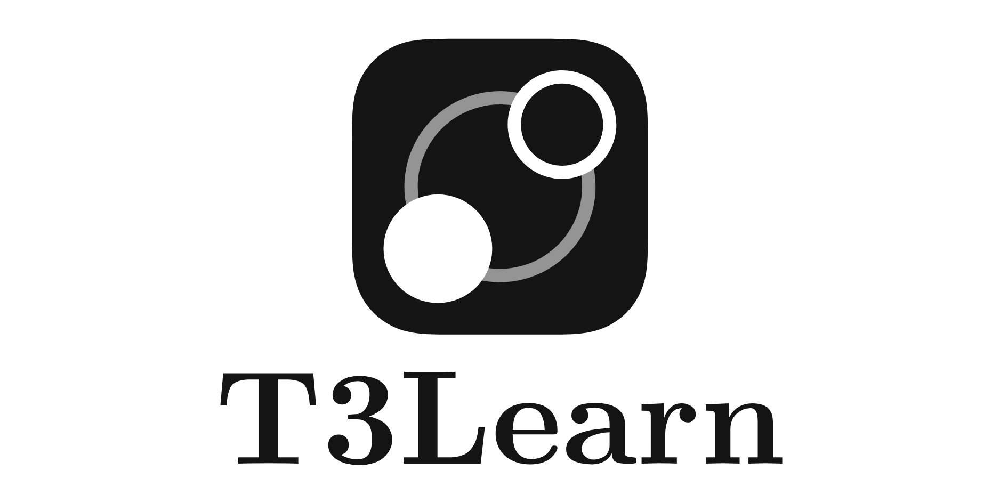
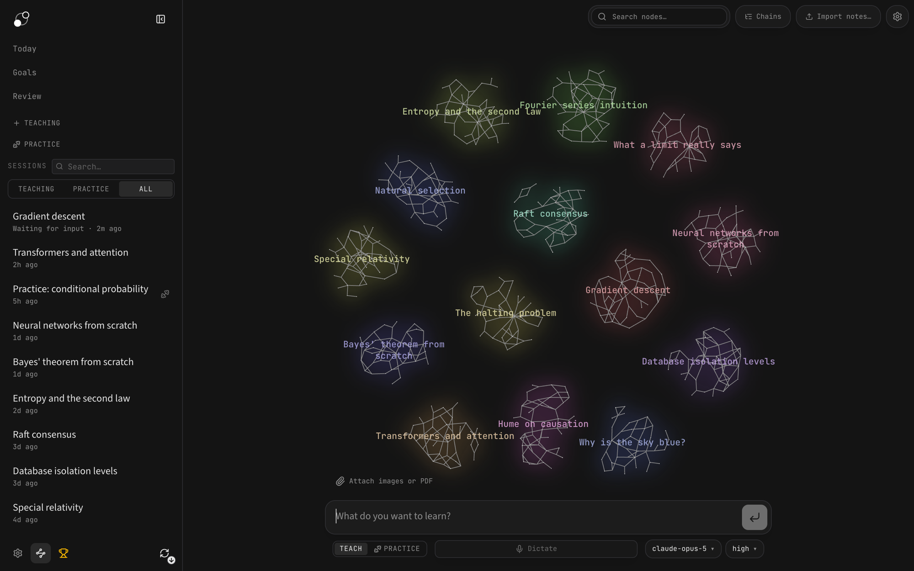
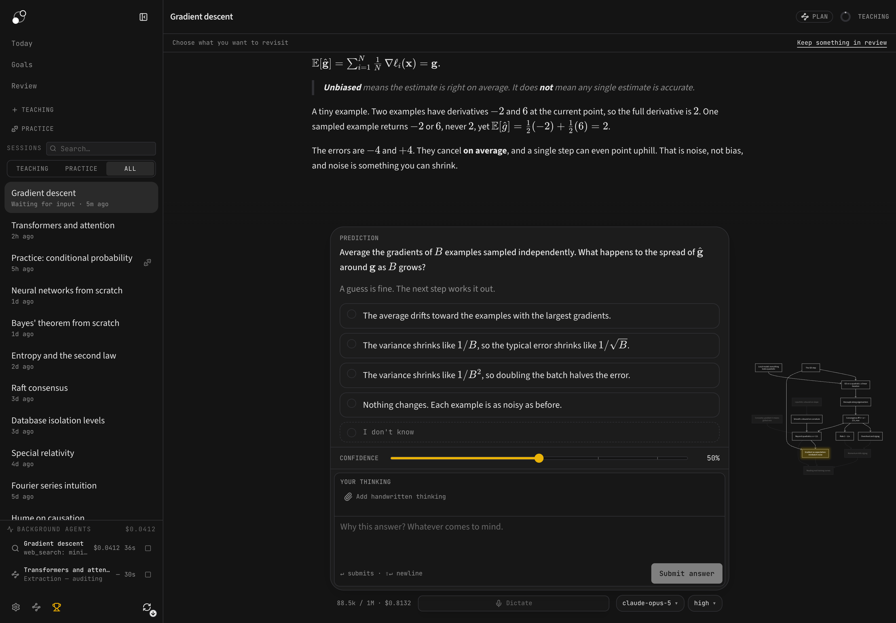
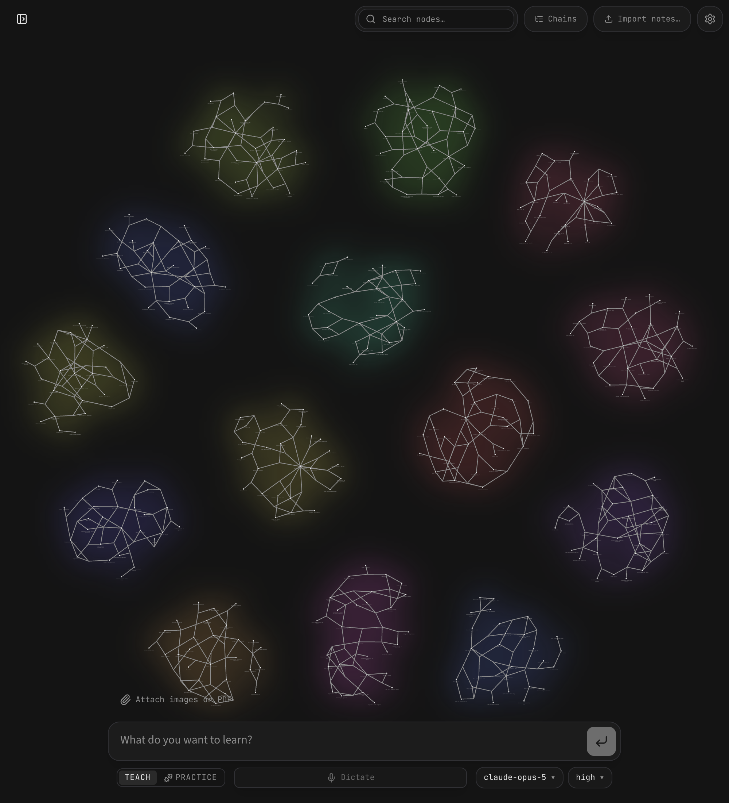
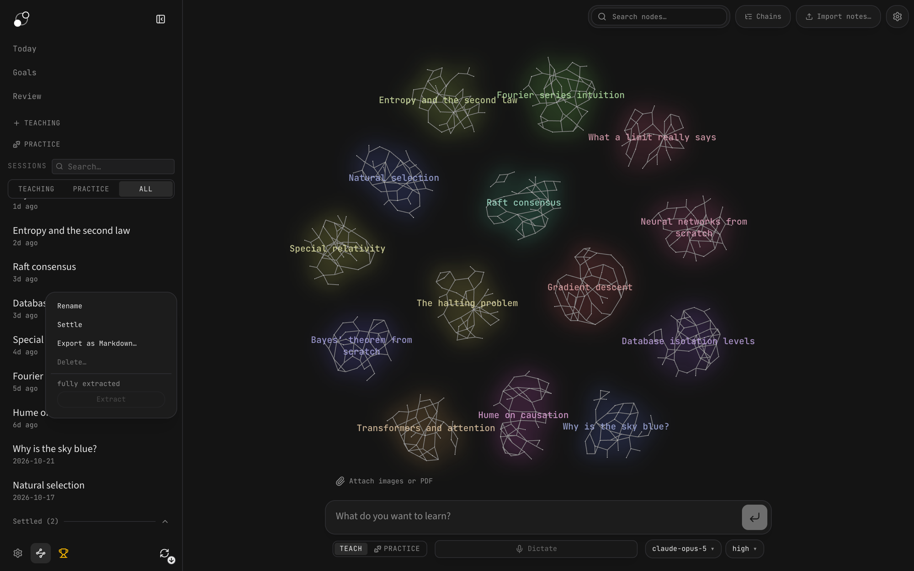
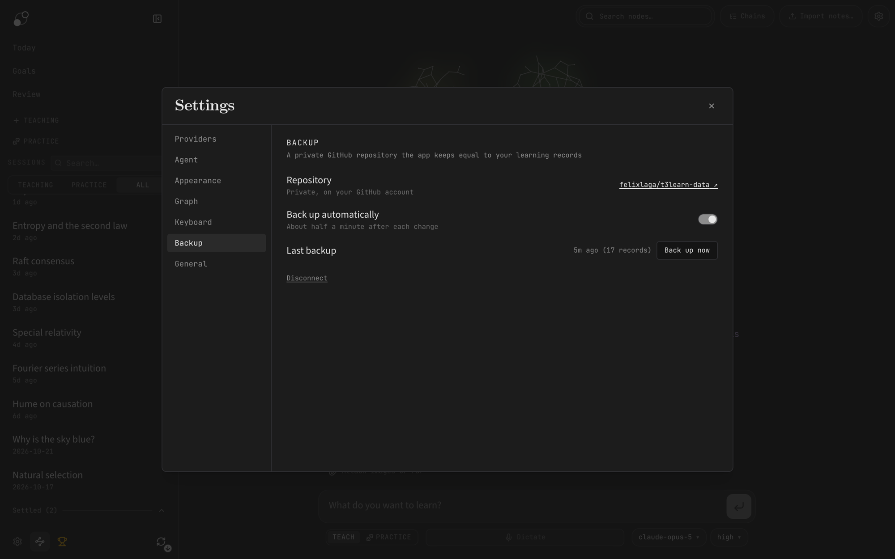

<p align="center">
  <picture>
    <source media="(prefers-color-scheme: dark)" srcset="docs/assets/t3learn_banner_dark.png">
    <source media="(prefers-color-scheme: light)" srcset="docs/assets/t3learn_banner_light.png">
    
  </picture>
</p>

<p align="center"><strong>T3Learn: an agent that teaches you one reasoning step at a time, on your Mac, with your own keys or subscriptions.</strong></p>

<p align="center">
  <a href="https://github.com/felixlaga/t3learn/releases/download/local-latest/T3Learn.dmg">Download for Mac</a> ·
  <a href="#how-it-works">How it works</a> ·
  <a href="#your-sessions">Sessions</a> ·
  <a href="#backup">Backup</a> ·
  <a href="docs/development.md">Documentation</a> ·
  <a href="https://github.com/felixlaga/t3learn/issues">Issues</a>
</p>

T3Learn teaches you one reasoning step at a time. A teacher agent finds where your understanding ends, plans a path to your goal, teaches each step, and checks it with questions. What you learn becomes a knowledge graph that later sessions can read.

It runs as a Mac app that updates itself. It works with API keys or with your Codex and Claude Code subscriptions, and it backs up everything you learn to a private GitHub repository.



## What you get

- **A Mac app you install once.** Download the DMG and drag it to Applications. New builds arrive in the app, and one click installs them.
- **Your subscriptions, not only API keys.** Use your Codex CLI or Claude Code login as a model provider. Every API-key provider works too.
- **A calm sidebar.** The bottom row is an icon row: Settings, the graph, Progress and the update button. Sessions you are done with go into a collapsed **Settled** shelf.
- **Automatic backup.** The app creates a private GitHub repository for your learning records and keeps it up to date after every change.
- **Daily learning.** Today, Goals and Review pages for a daily session with spaced review.
- **Lesson material.** Attach images or PDF pages, and turn handwritten thinking into editable text.

## Download and first run

**Download:** <https://github.com/felixlaga/t3learn/releases/download/local-latest/T3Learn.dmg> (Apple Silicon). The link always points at the newest build.

The app is not signed with an Apple Developer ID, so macOS blocks the first open once. Right-click T3Learn.app and choose **Open**, or allow it under **System Settings → Privacy & Security → Open Anyway**. After that it opens normally and updates itself.

The first run takes three short steps:

1. **A provider.** Paste an API key, or connect Codex CLI or Claude Code. Install the CLI, sign in once in Terminal, then click **Use existing login** in Settings → Providers.
2. **Three models.** Pick a strong model for teaching, a cheap one for background work, and a vision model for images and PDFs.
3. **Backup (optional).** Connect GitHub and name the private repository. You can also do this later in Settings → Backup.

Then type what you want to understand and start a session.

Prefer to build it yourself? Run `npm ci`, then `npm run desktop:local`. That writes `dist/local/mac-arm64/T3Learn.app`. Details are in [CLI setup and local macOS builds](docs/local-desktop.md).

## How it works

1. **Measure.** Before teaching, the agent finds where your understanding ends on each part the lesson depends on. Your answers, confidence and thinking show it where to start.
2. **Plan.** It works out a dependency map from that starting point to your goal. You can see the plan, and the lesson adapts when your understanding turns out different.
3. **Teach.** Each step builds on something you already understand. You predict, get an explanation, and check your understanding. Confusions are repaired before anything is built on them.
4. **Practice.** Separate sessions pose varied problems that need the right knowledge to come to mind without being named first. Problems and hints adapt to your reasoning.



**Think out loud.** The thinking field under each question is where you explain your reasoning, doubts and reactions in your own words. The agent uses it to build a detailed picture of how you think, not only a record of right and wrong answers. Type, or dictate.

The agent can also research questions in the background, draw visual explanations, and build interactive demonstrations. Background work shows in the sidebar while it runs.

## Knowledge that carries forward

What you are taught accumulates as propositions and reasoning chains. A proposition is a single claim. A chain links the premises that lead to a conclusion. The graph is the app's home page, and each node links back to the session that taught it. You can also import your own notes.

Later sessions read the graph instead of starting from scratch, and practice sessions can draw their material from it. The graph stores ideas and their connections, not ratings of your ability.



## Your sessions

The sidebar lists your teaching and practice sessions, newest activity first. Search finds any session by title. The filter row shows teaching, practice, or all.

**Settle a session** when you are done with it. Right-click the row and choose **Settle**. It moves into the collapsed **Settled (N)** shelf at the bottom of the list. Click the shelf to open it, and a search opens it for its matches. **Un-settle** brings a session back to the top. Nothing settles on its own.



The icon row at the bottom holds, from left to right:

| Icon | What it does |
|---|---|
| Gear | Settings (also ⌘,) |
| Graph | Back to the knowledge graph (also ⌘G) |
| Trophy | Progress: XP, levels, streaks, badges and knowledge-map counts |
| Circular arrow | Updates. A check means up to date. A down arrow means a new build is ready to download. An accent check means restart to install. |

## Backup

**Settings → Backup** keeps a private GitHub repository equal to your learning records. The app creates the repository and pushes one commit about half a minute after each change. You do not need git or gh installed.



1. **Connect GitHub.** The app shows a short code. Enter it at github.com/login/device and confirm. Or paste a token.
2. **Name the repository.** The app proposes `t3learn-data` and creates it as private. It refuses a public repository of that name.
3. **Done.** The section shows the last push, lets you push now, and lists anything left out.

What goes: your sessions, the knowledge graph, learning goals and review, and non-secret settings. What never goes: API keys, logins, CLI state, logs, jobs and attachment files. Every push builds on the last one, so history keeps every earlier snapshot. Nothing is ever force-pushed. Restore on a new Mac with `npm run data:restore`. The full rules, the restore steps and the manual backup script are in [learning data and backups](docs/learning-data.md).

## Updates

Every push to `main` builds the app on GitHub Actions and publishes it to the `local-latest` prerelease. The installed app checks that release at launch and once a day, and the update button in the sidebar offers the build. Click it to download, then **Restart to update**. The app swaps itself in place and reopens. **Check for Updates…** in the app menu checks by hand. The mechanics are in [local-desktop.md](docs/local-desktop.md#updates).

## Your keys, your data

- **Your keys and models.** There is no T3Learn subscription or markup. You pay your providers for usage, and a live cost meter shows model costs. Subscription usage is labeled separately.
- **Local storage.** Chats, graph, settings and API keys live on your machine as plain files you can inspect. The backup copies the learning records to a private repository you own.
- **External services.** Models run through your configured providers. Model requests send the context the task needs. Web research and dictation also contact external services. Local storage does not mean offline processing.
- **Inspectable behavior.** System prompts are visible and editable. The code is open under the AGPL-3.0 license.

## Development and support

```bash
npm install
npm run dev        # http://localhost:3000
npm test           # deterministic, no LLM, no network
```

See the [development guide](docs/development.md), the [architecture](docs/architecture.md), the [desktop release guide](docs/desktop-release.md) and the [daily learning guide](docs/daily-learning.md). The README screenshots come from demo data that `scripts/readme-demo/seed.mts` builds.

Questions, bug reports and feature requests go to [GitHub Issues](https://github.com/felixlaga/t3learn/issues).

## License

[AGPL-3.0](LICENSE). Credits and retained license notices are in [docs/credits.md](docs/credits.md).
